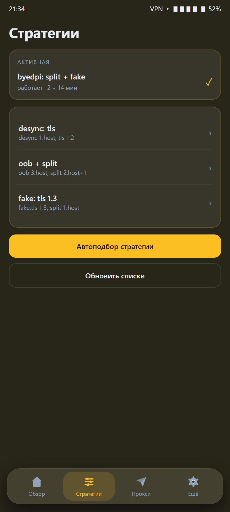
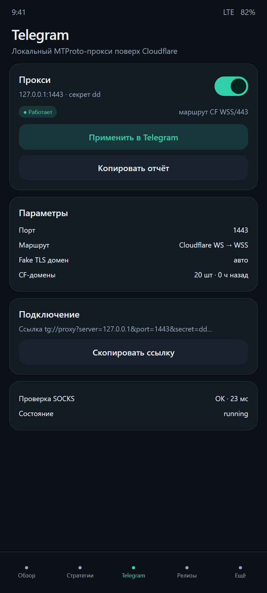

# Zapret Manager для Android

<p align="center">
  
</p>

Единый менеджер ускорения Интернета для Android: **ускорение соединения** (byedpi + hev-socks5-tunnel) и
**локальный MTProto-прокси для Telegram** (рантайм TG WS Proxy) в одном приложении.

[](https://github.com/RoBiN19666/ZapretManager-Android/actions/workflows/android.yml)
[](https://github.com/RoBiN19666/ZapretManager-Android/releases)
[](LICENSE)

## Как выглядит

<p align="center">
  
  
  
</p>
<p align="center">
  
</p>

<sub>Макеты экранов в актуальной палитре и с реальными подписями; в приложении — те же разделы.</sub>

Продолжение десктопного [ZapretManager](https://github.com/RoBiN19666/ZapretManager-Desktop) на Android:
те же принципы (стратегии, автообновления, диагностика), но с учётом мобильных ограничений —
без root, без системных iptables, всё через `VpnService` и локальный прокси. Иконка и логотип
взяты из десктопной версии.

## Что умеет

| Раздел | Возможности |
| --- | --- |
| **Обзор** | Два независимых движка: ускорение соединения и Telegram-прокси. Статус, uptime, активная стратегия, проверка сервисов через SOCKS-порт byedpi (YouTube/Discord/Telegram/Cloudflare), живой журнал, кнопка подключения Telegram |
| **Стратегии** | Четыре источника: встроенные наборы, авторские пресеты byedpi, список ByeByeDPI и свои (ручной ввод + импорт списком). Поиск, счётчики по источникам, мгновенное применение. **Тест всех стратегий на живом туннеле** (YouTube/Discord/Telegram/Cloudflare) с выбором лучшей. **Глубокий автоподбор параметров**: split/disorder/OOB/fake TLS/tlsrec/mod-http, комбинации и модификаторы — с сохранением собранной команды |
| **Telegram** | Локальный MTProto-прокси на `127.0.0.1`, маршруты `cf_proxy_ws` / `direct_ws` / `tcp_fallback`, Fake TLS домен, ссылки `tg://`, `t.me`, SOCKS5, автозапуск |
| **Обновления** | Самообновление APK из GitHub Releases (SHA-256 + подпись + versionCode), обновление стратегий и списков сайтов из ByeByeDPI, пула Cloudflare-доменов из Flowseal/tg-ws-proxy |
| **Настройки** | Тема (системная/светлая/тёмная), **акцентный цвет и AMOLED-фон**, автозапуск, DNS, IPv6, режимы раздельного туннелирования (все / кроме выбранных / только выбранные), настройки энергии, **профили сети (Wi-Fi/оператор) с автопереключением**, **редактор списков сайтов (8 файлов, дубли, откат)**, **проверка сайта (DNS → TCP → TLS → HTTP)**, **резервная копия и восстановление**, **полная диагностика (23 проверки с кнопками исправления)**, экспорт журнала |
| **Плитка** | Быстрое включение ускорения из шторки (Quick Settings) |

## Как это устроено

```
┌─────────────────────────── приложение ───────────────────────────┐
│                                                                  │
│  UI-процесс (Compose)                                            │
│    ├── DpiEngine        — управление VpnService                  │
│    ├── TgProxyController— управление Telegram-прокси             │
│    └── UpdateManager    — компоненты и самообновление            │
│                                                                  │
│  Процесс :native                     Главный процесс             │
│    ByeDpiVpnService                    TgProxyService            │
│      VpnService.Builder                  libtgwsproxy.so (Go)    │
│        tun-fd                                  │                 │
│        ↓                                       │                 │
│      libhev-socks5-tunnel.so  (tun2socks)      │                 │
│        ↓ SOCKS5 127.0.0.1:1080                 │                 │
│      libzapretnative.so (byedpi, desync)       │                 │
└──────────────────────────────────────────────────────────────────┘
```

* **Ускорение соединения** — `VpnService` поднимает tun, весь трафик попадает в userspace-стек
  `hev-socks5-tunnel`, оттуда — в `byedpi`, который выполняет desync-трюки (split, fake TLS,
  OOB, disorder). Приложения видят обычную сеть; root не нужен.
* **Telegram** — локальный MTProto-прокси слушает `127.0.0.1:1443`, Telegram подключается по
  ссылке `tg://proxy`, трафик уходит через Cloudflare Proxy по WebSocket. Системный VPN для
  этого не требуется, остальные приложения идут напрямую.
* Движки живут в сабмодулях (`third_party/tgwsproxy`, `app/src/main/cpp/byedpi`,
  `app/src/main/jni/hev-socks5-tunnel`) и собираются из исходников при сборке APK.

## Установка

> **2.0.0: смена ключа подписи.** Старый ключ был опубликован и скомпрометирован,
> поэтому APK 2.0.0 **не устанавливается поверх 1.x**. Сделайте
> «Настройки → Резервная копия → Экспорт» в старой версии, удалите её,
> установите 2.0.0 и импортируйте архив. Это разовая миграция; дальше
> обновления снова будут обычными.

1. Скачайте APK из [Releases](https://github.com/RoBiN19666/ZapretManager-Android/releases).
2. Разрешите установку из этого источника (Android спросит сам).
3. Для ускорения соединения подтвердите запрос VPN при первом включении.
4. Для Telegram: включите прокси → «Применить в Telegram» → подтвердите.

> **Play Protect может показать «Вредоносное приложение недоступено»** — это ложное
> срабатывание для самоподписанных VPN-утилит. Что делать и как проверить SHA-256:
> [docs/PLAY_PROTECT.md](docs/PLAY_PROTECT.md).

Требования: Android 8.0+ (`minSdk 26`), ARM64 (`arm64-v8a`) или ARMv7 (`armeabi-v7a`).

## Обновления

* **Менеджер** обновляется из собственных GitHub Releases: приложение сравнивает версии,
  скачивает APK, проверяет SHA-256 из релиза, сертификат подписи и `versionCode`, затем
  передаёт файл системному установщику. Репозиторий публичный, поэтому проверка и загрузка
  работают без авторизации.
* **2.0.0 — исключение:** ключ подписи сменён из-за компрометации. Старая версия
  отклонит APK 2.0.0 (это ожидаемо); нужна переустановка по инструкции выше.
  Следующие версии 2.x обновляются штатно.
* **Стратегии и списки сайтов** — из репозитория `romanvht/ByeByeDPI` (по коммитам).
* **Пул Cloudflare-доменов** — из `Flowseal/tg-ws-proxy`.
* **Движки** собираются в APK, поэтому обновляются вместе с приложением; GitHub Actions
  еженедельно проверяет upstream-репозитории и поднимает сабмодули (см. `upstream.yml`).

Релизы собираются **по требованию**, а не на каждый коммит: вручную (Actions → Android CI →
Run workflow, либо `scripts/release.ps1`) или тегом `v*`. Текст обновления берётся из раздела
`## <версия>` в [CHANGELOG.md](CHANGELOG.md) — он виден и в приложении на экране «Обновления».

## Сборка

Нужны JDK 17, Android SDK 35, NDK 27, CMake 3.22.1 и Go 1.25+.

```bash
git clone --recursive https://github.com/RoBiN19666/ZapretManager-Android.git
cd ZapretManager-Android

# 1. Go-рантайм Telegram → app/src/main/jniLibs/<abi>/libtgwsproxy.so
bash scripts/build-tgws.sh          # Windows: .\scripts\build-tgws.ps1

# 2. byedpi + tun2socks собираются Gradle (CMake + ndk-build) автоматически
./gradlew :app:assembleRelease -PappVersionName=2.0.0 -PappVersionCode=200
```

APK: `app/build/outputs/apk/release/`. Debug-сборка: `./gradlew :app:assembleDebug`.

Подробнее — [docs/BUILD.md](docs/BUILD.md).

## Подпись

Приватный ключ **не хранится в репозитории**. Локально он лежит вне проекта
(`~/.zapretmanager/release-2026.jks`), в CI — в GitHub Actions Secrets
(`ANDROID_KEYSTORE_BASE64`, `ANDROID_KEYSTORE_PASSWORD`, `ANDROID_KEY_ALIAS`,
`ANDROID_KEY_PASSWORD`). Для локальной сборки можно создать
`keystore.properties` в корне (он в `.gitignore`).

Сертификат 2.0.0:
`SHA-256 DB:AB:2D:4E:D5:B9:E5:0A:13:28:3D:F7:01:C3:4D:1A:60:40:D5:9A:29:11:79:D3:7B:13:44:AC:BA:55:35:C2`.
Старый ключ `keystore/zapretmanager.jks` удалён из рабочего дерева, активной истории,
тегов и релизов; он считался скомпрометированным и больше не используется. GitHub
может хранить недостижимые объекты/кэши — для полного удаления нужен запрос в
поддержку GitHub.

## Ограничения

* Прокси для Telegram — не системный VPN: он обрабатывает только то, что Telegram отправляет
  в локальный прокси.
* `awg_warp`-маршрут (AmneziaWG/WARP) в этой сборке не включён: используется проверенный набор
  `cf_proxy_ws` / `direct_ws` / `tcp_fallback`.
* Один экземпляр byedpi на процесс: остановка ускорения завершает процесс `:native` — так
  задумано в движке, UI-процесс не страдает.
* Нет автоматического переподключения при смене сети: после смены Wi-Fi ↔ мобильной сети
  ускорение может потребовать перезапуска.

## Благодарности и лицензии

Проект не содержит чужого кода в исходниках, но **линкует** GPL-компонент, поэтому
распространяется по **GPL-3.0** (см. [LICENSE](LICENSE)).

* [hufrea/byedpi](https://github.com/hufrea/byedpi) — desync-движок (MIT).
* [heiher/hev-socks5-tunnel](https://github.com/heiher/hev-socks5-tunnel) — tun2socks (MIT).
* [romanvht/ByeByeDPI](https://github.com/romanvht/ByeByeDPI) — Android-обвязка VpnService и списки стратегий (GPL-3.0).
* [Regstar2/tg-ws-proxy-android](https://github.com/Regstar2/tg-ws-proxy-android) — Go-рантайм MTProto-прокси (GPL-3.0).
* [Flowseal/tg-ws-proxy](https://github.com/Flowseal/tg-ws-proxy) — пул Cloudflare-доменов.
* [bol-van/zapret](https://github.com/bol-van/zapret) — идеи desync-ускорения, вдохновившие десктопную версию.

Автор: RoBiN19666. Проект не связан с Telegram, Cloudflare и перечисленными авторами.
