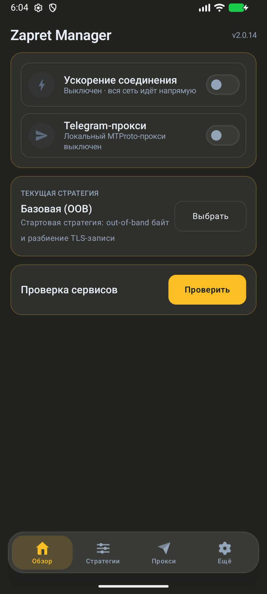
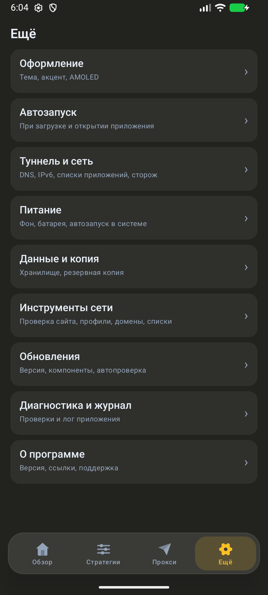

# Zapret Manager для Android

<p align="center">
  
</p>

Единый менеджер ускорения Интернета для Android: **ускорение соединения** (byedpi + hev-socks5-tunnel) и
**локальный MTProto-прокси для Telegram** (рантайм TG WS Proxy) в одном приложении.

[](https://github.com/RoBiN19666/ZapretManager-Android/actions/workflows/android.yml)
[](https://github.com/RoBiN19666/ZapretManager-Android/releases)
[](LICENSE)

## Как выглядит

<p align="center">
  
  
  
  
</p>

<sub>Скриншоты сняты с работающего приложения на эмуляторе Android 16 (1080×2400, x86_64):
тёмная тема, русская локаль, реальные данные экранов. Нижнее меню — плавающая панель
с собственными иконками, содержимое страниц прокручивается под ней и под статус-баром.</sub>

Продолжение десктопного [ZapretManager](https://github.com/RoBiN19666/ZapretManager-Desktop) на Android:
те же принципы (стратегии, автообновления, диагностика), но с учётом мобильных ограничений —
без root, без системных iptables, всё через `VpnService` и локальный прокси. Иконка и логотип
взяты из десктопной версии.

## Что умеет

| Раздел | Возможности |
| --- | --- |
| **Обзор** | Два независимых движка: ускорение соединения и Telegram-прокси. Статус и uptime, активная стратегия, проверка сервисов через SOCKS-порт byedpi (YouTube/Discord/Cloudflare) и **проверка локального Telegram-прокси**, кнопка подключения Telegram. Состояние движков проверяется по локальным портам, поэтому «работает» не остаётся на экране после молчаливой остановки процесса |
| **Стратегии** | Четыре источника: встроенные наборы, авторские пресеты byedpi, список ByeByeDPI и свои. Свои аргументы можно **сохранить под именем**, применить одним нажатием или удалить по одной записи, а также импортировать списком. Поиск, счётчики по источникам, мгновенное применение. **Тест всех стратегий на живом туннеле** (YouTube/Discord/Telegram/Cloudflare) с выбором лучшей. **Глубокий автоподбор параметров**: готовые пресеты + split/disorder/OOB/fake TLS/tlsrec/mod-http, комбинации и модификаторы, финальная проверка лидеров. Результат подбора **запоминается для текущей сети** |
| **Telegram** | Локальный MTProto-прокси на `127.0.0.1`, маршруты `cf_proxy_ws` / `direct_ws` / `tcp_fallback`, Fake TLS домен, ссылки `tg://`, `t.me`, SOCKS5, автозапуск |
| **Обновления** (в «Ещё») | Самообновление APK из GitHub Releases (SHA-256 + versionCode), обновление стратегий и списков сайтов из ByeByeDPI, пула Cloudflare-доменов из Flowseal/tg-ws-proxy |
| **Настройки** | Раздел «Ещё» с подразделами: оформление, автозапуск, туннель и сеть, питание, данные и копия, инструменты сети, обновления, диагностика и журнал, о программе. Тема (системная/светлая/тёмная), **янтарный акцент по умолчанию** и палитра по градиенту, **фон подстраивается под акцент или выбирается отдельно**, AMOLED-чёрный, DNS, IPv6, режимы раздельного туннелирования (все / кроме выбранных / только выбранные), **питание с учётом прошивки** (Xiaomi/HyperOS, Huawei, Samsung, OPPO/realme, vivo, Meizu — свой экран батареи и автозапуска), **профили сети (Wi-Fi/оператор) с автопереключением**, **редактор списков сайтов (8 файлов, дубли, откат)**, **проверка сайта (DNS → TCP → TLS → HTTP)**, **резервная копия и восстановление**, **полная диагностика (25 проверок с кнопками исправления, на прошивках производителей — с проверкой автозапуска)**, журнал |
| **Расписание** | Окно работы обхода: вне окна движок выключается, внутри — включается обратно (если выключило именно расписание). Окно может быть через полночь, например 23:00–07:00 |
| **Журнал** | Экспорт журнала в файл с версией, устройством и ABI, отправка через «Поделиться»; хранятся последние пять файлов |
| **Плитка** | Быстрое включение ускорения из шторки (Quick Settings) |

## Как это устроено

```
┌─────────────────────────── приложение ───────────────────────────┐
│                                                                  │
│  UI-процесс (Compose)                                            │
│    ├── DpiEngine        — управление VpnService                  │
│    ├── TgProxyController— управление Telegram-прокси             │
│    └── UpdateManager    — компоненты и самообновление            │
│                                                                  │
│  Процесс :native                     Главный процесс             │
│    ByeDpiVpnService                    TgProxyService            │
│      VpnService.Builder                  libtgwsproxy.so (Go)    │
│        tun-fd                                  │                 │
│        ↓                                       │                 │
│      libhev-socks5-tunnel.so  (tun2socks)      │                 │
│        ↓ SOCKS5 127.0.0.1:1080                 │                 │
│      libzapretnative.so (byedpi, desync)       │                 │
└──────────────────────────────────────────────────────────────────┘
```

* **Ускорение соединения** — `VpnService` поднимает tun, весь трафик попадает в userspace-стек
  `hev-socks5-tunnel`, оттуда — в `byedpi`, который выполняет desync-трюки (split, fake TLS,
  OOB, disorder). Приложения видят обычную сеть; root не нужен.
* **Telegram** — локальный MTProto-прокси слушает `127.0.0.1:1443`, Telegram подключается по
  ссылке `tg://proxy`, трафик уходит через Cloudflare Proxy по WebSocket. Системный VPN для
  этого не требуется, остальные приложения идут напрямую.
* Движки живут в сабмодулях (`third_party/tgwsproxy`, `app/src/main/cpp/byedpi`,
  `app/src/main/jni/hev-socks5-tunnel`) и собираются из исходников при сборке APK.
* **Живость движков** проверяется по локальным портам (`127.0.0.1:1080` для byedpi,
  выбранный порт для Telegram): если процесс `:native` или `:tg` умер молча, интерфейс
  покажет ошибку, а не «работает». Для Telegram дополнительно проверяется, что рантайм
  действительно открыл порт перед тем, как считаться запущенным.
* **Подбор по сетям**: результат автоподбора и теста стратегий записывается в профиль
  текущей сети (`files/network-profiles.json`), поэтому при переходе Wi-Fi ↔ мобильная
  сеть включаются свои параметры, а не последние выбранные вручную.
* **Восстановление после остановки системой**: сервисы возвращают `START_STICKY` и
  помнят, что движок должен работать (`files/…/zm_engine_state`). Если HyperOS/Doze
  убьёт процесс, система перезапустит сервис, а он поднимет туннель заново — не больше
  трёх попыток за 10 минут, чтобы не уйти в цикл.

## Установка

> Обновляетесь с предыдущей версии? Сделайте «Настройки → Резервная копия → Экспорт»
> перед установкой. Секрет Telegram-прокси в архив не входит — после восстановления
> Telegram попросит применить ссылку заново (это защита от утечки архива).

1. Скачайте APK из [Releases](https://github.com/RoBiN19666/ZapretManager-Android/releases).
2. Разрешите установку из этого источника (Android спросит сам).
3. Для ускорения соединения подтвердите запрос VPN при первом включении.
4. Для Telegram: включите прокси → «Применить в Telegram» → подтвердите.

> **Play Protect может показать «Вредоносное приложение недоступено»** — это ложное
> срабатывание для самоподписанных VPN-утилит. Что делать и как проверить SHA-256:
> [docs/PLAY_PROTECT.md](docs/PLAY_PROTECT.md).

Требования: Android 8.0+ (`minSdk 26`), ARM64 (`arm64-v8a`) или ARMv7 (`armeabi-v7a`).

### Какой файл качать

В релизе три APK — берите под свою архитектуру, разница в размере существенная:

| Устройство | Файл | Размер |
| --- | --- | --- |
| Почти все телефоны (Android 8+, 64-бит) | `ZapretManager-Android-arm64-v8a-vX.apk` | ≈6.4 МБ |
| Старые 32-битные устройства | `ZapretManager-Android-armeabi-v7a-vX.apk` | ≈6.6 МБ |
| Не уверены / нестандартный набор ABI | `ZapretManager-Android-universal-vX.apk` | ≈11 МБ |

Разница — только в нативных библиотеках: в универсальный APK упакованы оба комплекта
(в основном Go-рантайм Telegram), в ABI-сборке — один. Приложение обновляется само и
выбирает файл под свою архитектуру по имени ассета, поэтому вручную об этом думать
нужно только при первой установке.

## Обновления

* **Менеджер** обновляется из собственных GitHub Releases: приложение сравнивает версии,
  скачивает APK, проверяет SHA-256 из релиза и `versionCode`, затем передаёт файл
  системному установщику. Репозиторий публичный, поэтому проверка и загрузка работают
  без авторизации.
* **Стратегии и списки сайтов** — из репозитория `romanvht/ByeByeDPI` (по коммитам).
* **Пул Cloudflare-доменов** — из `Flowseal/tg-ws-proxy`.
* **Движки** собираются в APK, поэтому обновляются вместе с приложением; GitHub Actions
  еженедельно проверяет upstream-репозитории и поднимает сабмодули (см. `upstream.yml`).

Релизы собираются **по требованию**, а не на каждый коммит: вручную (Actions → Android CI →
Run workflow, либо `scripts/release.ps1`) или тегом `v*`. Текст обновления берётся из раздела
`## <версия>` в [CHANGELOG.md](CHANGELOG.md) — он виден и в приложении на экране «Обновления».
Обычные коммиты и pull request-ы проверяются отдельным workflow **Check** (unit-тесты и
`lintDebug`, без публикации артефактов).

## Сборка

Нужны JDK 17, Android SDK 35, NDK 27, CMake 3.22.1 и Go 1.25+.

```bash
git clone --recursive https://github.com/RoBiN19666/ZapretManager-Android.git
cd ZapretManager-Android

# 1. Go-рантайм Telegram → app/src/main/jniLibs/<abi>/libtgwsproxy.so
bash scripts/build-tgws.sh          # Windows: .\scripts\build-tgws.ps1

# 2. byedpi + tun2socks собираются Gradle (CMake + ndk-build) автоматически
./gradlew :app:assembleRelease -PappVersionName=2.0.0 -PappVersionCode=200
```

APK: `app/build/outputs/apk/release/`. Debug-сборка: `./gradlew :app:assembleDebug`.

Подробнее — [docs/BUILD.md](docs/BUILD.md).

## Проверки

* `./gradlew :app:testDebugUnitTest` — 98 JVM-тестов: стратегии, профили сетей, порты,
  резервные копии, обновления, расписание, секрет Telegram-прокси и **UI-тесты Compose**
  на Robolectric (кнопки, карточки, нижнее меню, новогодний режим);
* `./gradlew :app:lintDebug` — Android Lint, ошибки валят сборку;
* CI (`.github/workflows/check.yml`) прогоняет тесты и lint на каждый push и PR
  и выгружает отчёты артефактами.

## Ограничения

* Прокси для Telegram — не системный VPN: он обрабатывает только то, что Telegram отправляет
  в локальный прокси.
* `awg_warp`-маршрут (AmneziaWG/WARP) в этой сборке не включён: используется проверенный набор
  `cf_proxy_ws` / `direct_ws` / `tcp_fallback`.
* Один экземпляр byedpi на процесс: остановка ускорения завершает процесс `:native` — так
  задумано в движке, UI-процесс не страдает.
* Переключение профилей сети (Wi-Fi ↔ мобильная сеть) работает, пока приложение живо:
  наблюдатель сети живёт в основном процессе. Для переключения при закрытом приложении нужен
  отдельный foreground-сервис (см. `docs/ROADMAP.md`).
* В резервную копию **не попадает секрет Telegram-прокси** (`tgSecret`): архив — обычный zip,
  который пересылают в мессенджерах. После восстановления секрет генерируется заново, поэтому
  ссылку `tg://proxy` нужно применить в Telegram повторно.

## Документы

* [Политика конфиденциальности](PRIVACY.md) — приложение ничего не собирает;
* [Материалы для каталогов](docs/STORE.md) — описание, разрешения и что нужно для F-Droid.

## Благодарности и лицензии

Проект не содержит чужого кода в исходниках, но **линкует** GPL-компонент, поэтому
распространяется по **GPL-3.0** (см. [LICENSE](LICENSE)).

* [hufrea/byedpi](https://github.com/hufrea/byedpi) — desync-движок (MIT).
* [heiher/hev-socks5-tunnel](https://github.com/heiher/hev-socks5-tunnel) — tun2socks (MIT).
* [romanvht/ByeByeDPI](https://github.com/romanvht/ByeByeDPI) — Android-обвязка VpnService и списки стратегий (GPL-3.0).
* [Regstar2/tg-ws-proxy-android](https://github.com/Regstar2/tg-ws-proxy-android) — Go-рантайм MTProto-прокси (GPL-3.0).
* [Flowseal/tg-ws-proxy](https://github.com/Flowseal/tg-ws-proxy) — пул Cloudflare-доменов.
* [bol-van/zapret](https://github.com/bol-van/zapret) — идеи desync-ускорения, вдохновившие десктопную версию.

Автор: RoBiN19666. Проект не связан с Telegram, Cloudflare и перечисленными авторами.

## Как готовился проект

Код, документация и разбор ошибок в этом репозитории готовились с помощью инструмента
**DeepSeek Harness** — агента для работы с кодовой базой: он читал проект, вносил правки,
собирал APK, запускал unit-тесты и lint.
